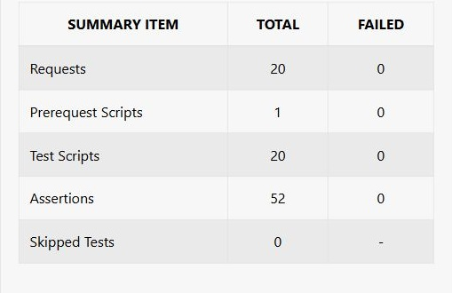
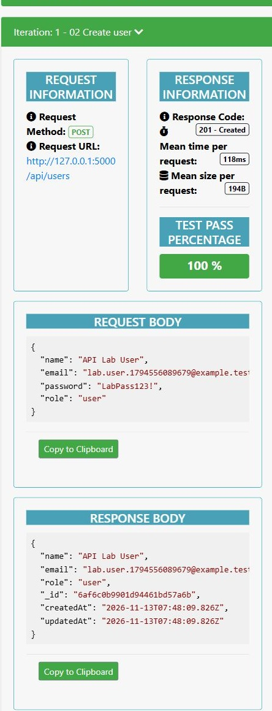
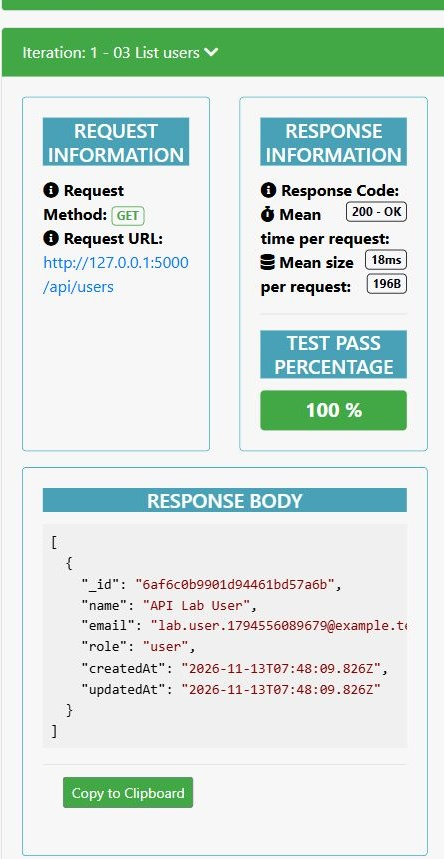
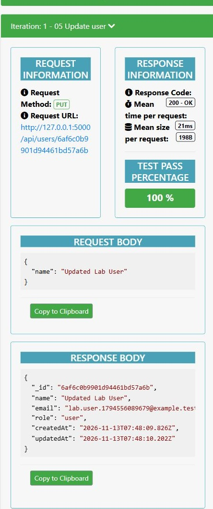
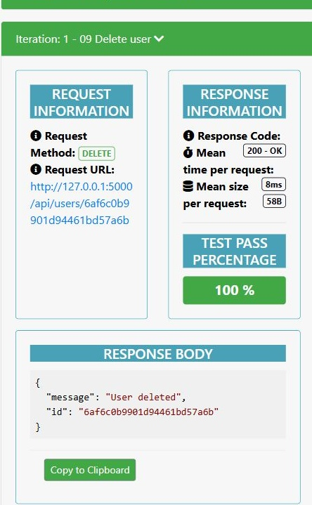
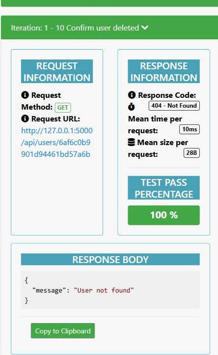
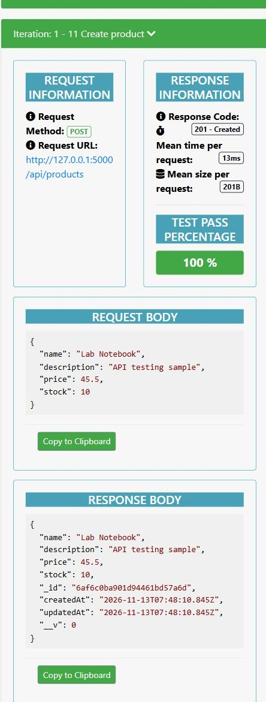
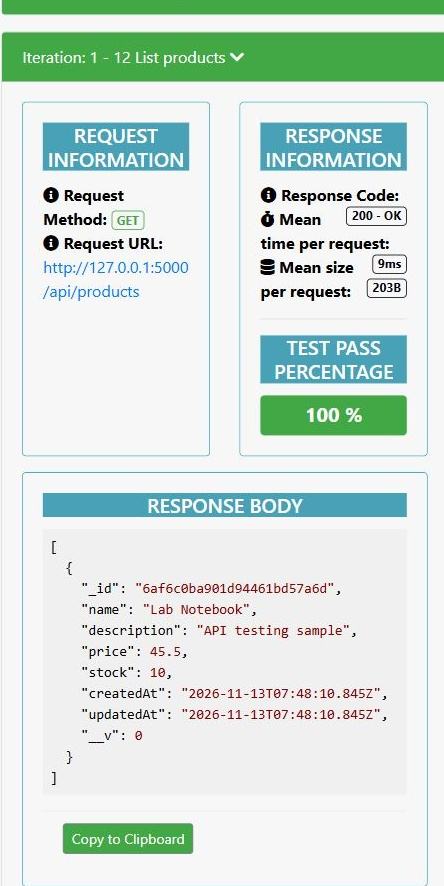
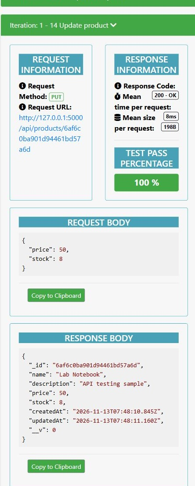
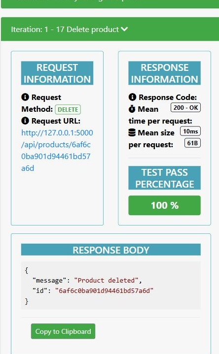

# Phase 2 Backend Development and API Integration

**Lab Report 4**  
IS Elec 2 - Web Systems and Technologies  
Group: Phase 2 Backend Team  
Project: User and Product Management API  
Date: 13 November 2026

## Group members

| Member | Role |
| --- | --- |
| Bea Roshan Pabilona | Project Manager and Documentation Officer |
| Christian Balauro | Backend Developer |
| Simranjit Singh | Database Manager |
| Karl James Matias | GitHub Manager using kjamesss |

## Overview of the backend setup

The backend runs locally with Node.js, Express, Mongoose, and MongoDB. It manages users and products through JSON requests. The included console demonstration and Postman collection show the actual backend output and results.

The title is Phase 2 Backend Development and API Integration. This corrects the Phase 3 typo in the supplied activity.

The project uses separate configuration, model, route, controller, and middleware files. Express starts after MongoDB connects and the indexes are ready. The server reads its port, connection string, and frontend origin from `.env`. The local `.env` is ignored by Git; `.env.example` is committed so another group member can reproduce the setup.

## Installation and local demonstration

```powershell
cd backend
npm ci
Copy-Item .env.example .env
# Terminal 1
npm run db:local
# Terminal 2, inside backend
npm start
# Terminal 3, inside backend
npm run demo
```

The database launcher downloads and runs a real local MongoDB executable using WiredTiger storage. It keeps development data under `backend/.local-db`. An existing local MongoDB server or Atlas connection can also be used. The integration tests use a separate temporary MongoDB database.

The required start script is `nodemon server.js`. Successful startup prints `MongoDB Connected` and `Server running on port 5000`. Run npm run demo to show the backend output in the console. The complete setup and API reference are in the [backend README](../backend/README.md).

## Server code

```javascript
require('dotenv').config({ path: require('node:path').join(__dirname, '.env') });
const mongoose = require('mongoose');
const connectDB = require('./config/db');
const app = require('./app');

async function start() {
  await connectDB();
  const port = Number(process.env.PORT || 5000);
  const server = app.listen(port, '127.0.0.1', () => {
    console.log(`Server running on port ${port}`);
  });
  server.on('error', async (error) => {
    console.error(`Server error: ${error.code || 'unknown'}`);
    await mongoose.disconnect();
    process.exitCode = 1;
  });
  const shutdown = () => server.close(async () => {
    await mongoose.disconnect();
    process.exit(0);
  });
  process.once('SIGINT', shutdown);
  process.once('SIGTERM', shutdown);
}

start().catch(async (error) => {
  console.error(error.message.startsWith('MONGO_URI')
    ? error.message : 'Startup failed. Check MongoDB availability and backend/.env.');
  await mongoose.disconnect();
  process.exitCode = 1;
});
```

`server.js` loads the environment, connects to MongoDB, and starts the Express application. Application middleware and route mounting are kept in `app.js` so the API can also be tested without opening a public network port.

## MongoDB connection code

```javascript
const mongoose = require('mongoose');

async function connectDB() {
  if (!process.env.MONGO_URI) throw new Error('MONGO_URI is required in backend/.env');
  await mongoose.connect(process.env.MONGO_URI, { serverSelectionTimeoutMS: 5000 });
  await Promise.all([
    require('../models/User').init(),
    require('../models/Product').init()
  ]);
  console.log('MongoDB Connected');
}

module.exports = connectDB;
```

Mongoose connects using `MONGO_URI`. Waiting for model initialization ensures the unique email index is ready before incoming requests are accepted. A startup connection failure prevents the HTTP server from starting.

## Sample user model

```javascript
const mongoose = require('mongoose');

const userSchema = new mongoose.Schema({
  name: { type: String, required: true, trim: true, minlength: 2, maxlength: 80 },
  email: {
    type: String, required: true, unique: true, lowercase: true, trim: true,
    maxlength: 254, match: /^[^\s@]+@[^\s@]+\.[^\s@]+$/
  },
  password: { type: String, required: true, select: false },
  role: { type: String, enum: ['user', 'admin'], default: 'user' }
}, { timestamps: true, strict: 'throw' });

userSchema.set('toJSON', {
  transform: (doc, ret) => { delete ret.password; delete ret.__v; return ret; }
});

module.exports = mongoose.model('User', userSchema);
```

The User schema validates names, email addresses, and roles. Email addresses are normalized to lowercase and indexed uniquely. The controller hashes each password with scrypt and a random salt before saving it. Passwords are excluded from JSON responses. The Product model validates product names, descriptions, nonnegative prices, and integer stock quantities.

## User routes

```javascript
const router = require('express').Router();
const controller = require('../controllers/userController');
const { validateId, validateBody } = require('../middleware/validate');
const fields = ['name', 'email', 'password', 'role'];

router.route('/')
  .post(validateBody(fields, ['name', 'email', 'password']), controller.create)
  .get(controller.list);
router.route('/:id')
  .all(validateId)
  .get(controller.get)
  .put(validateBody(fields), controller.update)
  .delete(controller.remove);

module.exports = router;
```

Routes direct each HTTP method to a controller. The shared controller creates, lists, retrieves, updates, and deletes Mongoose documents. PUT updates the fields supplied in the request and preserves omitted fields. ID and body validation run before controller logic. Product routes follow the same structure under `/api/products`.

## Routes and backend output

| Operation | User endpoint | Product endpoint | Expected status |
| --- | --- | --- | --- |
| Create | POST /api/users | POST /api/products | 201 |
| Read all | GET /api/users | GET /api/products | 200 |
| Read one | GET /api/users/:id | GET /api/products/:id | 200 |
| Update | PUT /api/users/:id | PUT /api/products/:id | 200 |
| Delete | DELETE /api/users/:id | DELETE /api/products/:id | 200 |
| Verify deletion | GET /api/users/:id | GET /api/products/:id | 404 |

The console demonstration sends actual HTTP requests to the running backend. It creates a sample user, reads the saved document, updates its name, deletes it, and confirms a 404 response. It repeats the sequence for a product. The complete output is saved in [backend-demo.txt](evidence/backend-demo.txt).

## Actual backend output

The following responses were read from the completed console demonstration. The same user ID is used for the update, deletion, and final 404 response.

```text
GET /api/health
HTTP 200
{
  "status": "ok",
  "database": "connected"
}

POST /api/users
HTTP 201
{
  "name": "Demo User",
  "email": "demo.1794560968420@example.test",
  "role": "user",
  "_id": "6af6d3c802ce658be0889dae",
  "createdAt": "2026-11-13T09:09:28.478Z",
  "updatedAt": "2026-11-13T09:09:28.478Z"
}

PUT /api/users/6af6d3c802ce658be0889dae
HTTP 200
{
  "_id": "6af6d3c802ce658be0889dae",
  "name": "Updated Demo User",
  "email": "demo.1794560968420@example.test",
  "role": "user",
  "createdAt": "2026-11-13T09:09:28.478Z",
  "updatedAt": "2026-11-13T09:09:28.501Z"
}

DELETE /api/users/6af6d3c802ce658be0889dae
HTTP 200
{
  "message": "User deleted",
  "id": "6af6d3c802ce658be0889dae"
}

GET /api/users/6af6d3c802ce658be0889dae
HTTP 404
{
  "message": "User not found"
}
```

The product demonstration also returned 201 for create, 200 for read, update, and delete, and 404 after deletion. Complete results are in [backend-demo.txt](evidence/backend-demo.txt) and [demo-results.json](evidence/demo-results.json).

## API testing results

The Postman collection was executed with Newman, Postman's command-line collection runner. The screenshots show the resulting request and response report, rather than the Postman desktop interface. The original collection and local environment are included for import into Postman.

| Check | Passed | Failed |
| --- | --- | --- |
| Database-backed integration tests | 37 | 0 |
| Postman requests | 20 | 0 |
| Postman assertions | 52 | 0 |

The tests also verify duplicate email rejection, invalid fields, malformed IDs, invalid JSON, password protection, pagination, CORS, and disconnected database health. The runtime dependency audit reported zero known vulnerabilities on the test date. Development-only Newman dependencies have upstream audit findings and are used only for local testing.



### Create a user

POST /api/users returned 201 Created. The response contains the saved ID and excludes the password.



### Retrieve users

GET /api/users returned 200 OK and included the user created in the preceding request.



### Update a user

PUT /api/users/:id returned 200 OK with the name Updated Lab User. A separate GET request confirmed that the change persisted.



### Delete a user

DELETE /api/users/:id returned 200 OK with a deletion message and the matching user ID.



### Confirm the user was deleted

GET for the same ID returned 404 Not Found after deletion.



### Create a product

POST /api/products returned 201 Created for Lab Notebook with price 45.5 and stock 10.



### Retrieve products

GET /api/products returned 200 OK and included the created product.



### Update a product

PUT /api/products/:id returned 200 OK with price 50 and stock 8.



### Delete a product

DELETE /api/products/:id returned 200 OK. The collection also confirmed a 404 response afterward.



## GitHub commits

Repository: [https://github.com/kjamesss/Phase-2-Backend-Development-and-API-Integration](https://github.com/kjamesss/Phase-2-Backend-Development-and-API-Integration)

The following commits were pushed through the authorized kjamesss account.

- [3b5c316](https://github.com/kjamesss/Phase-2-Backend-Development-and-API-Integration/commit/3b5c316549a7137c5090ff6aa3d027867bf6d5b5) Build modular Express backend with MongoDB models and complete CRUD routes
- [2e5ade4](https://github.com/kjamesss/Phase-2-Backend-Development-and-API-Integration/commit/2e5ade466f7bc39edbe172e27897b7e36645cbd8) Test user and product APIs with integration tests and a Postman collection
- [f4afc31](https://github.com/kjamesss/Phase-2-Backend-Development-and-API-Integration/commit/f4afc3119f9f815d493ac49ad72b0ad49632323a) Record successful API tests and add a backend-only console demonstration
- [16991cd](https://github.com/kjamesss/Phase-2-Backend-Development-and-API-Integration/commit/16991cd2d213d4962bb589ad8d2b481b394bcbe7) Add Phase 2 lab report with code snippets screenshots and rubric evidence
- [c3c0e7a](https://github.com/kjamesss/Phase-2-Backend-Development-and-API-Integration/commit/c3c0e7a5f9a00aaa47c918d7fe4fd4fd9477aebe) Preserve report and screenshot bytes across operating systems
- [306bc5b](https://github.com/kjamesss/Phase-2-Backend-Development-and-API-Integration/commit/306bc5bd136ce510b02f8064ad5932ed36ae958c) Restore required backend scope and console demonstration

The report and checklist are included in a subsequent documentation commit. The complete history is available in [GitHub commits](https://github.com/kjamesss/Phase-2-Backend-Development-and-API-Integration/commits/main/).

## Group contributions and ownership

The assigned roles below identify each member's responsibility for reviewing and maintaining the submitted work.

**Bea Roshan Pabilona**

Project management and documentation. Coordinates requirements, checks the report against the activity, and maintains the cover page, setup explanation, screenshots, and contribution record.

**Christian Balauro**

Backend development. Owns Express setup, user and product routes, reusable CRUD controllers, request validation, and the backend demonstration script.

**Simranjit Singh**

Database management. Owns the MongoDB connection, User and Product schemas, field validation, unique email index, and verification that updates and deletion persist.

**Karl James Matias**

GitHub management. Owns repository organization and clear commit messages. GitHub access and the submitted commits use the kjamesss account.

## Rubric evidence

| Criterion | Top descriptor | Evidence |
| --- | --- | --- |
| Backend Architecture Setup | Modular and scalable | server.js, app.js, config, models, controllers, routes, and middleware separate responsibilities. |
| MongoDB and Mongoose Integration | Connected and working | Actual MongoDB process, two Mongoose models, health response, and database-backed persistence tests. |
| REST API Route Functionality | CRUD endpoints tested | User and product CRUD pass in the Postman collection. The saved run has 20 requests and 52 passing assertions. |
| GitHub Commit and Documentation | Clear commits and README present | Pushed commits, root README, backend README, environment template, and committed report and evidence. |
| Lab Report Quality | Clear and well organized | Cover page, setup overview, exact code snippets, real testing screenshots, commit references, and member responsibilities. |

Each criterion is worth 10 points, for a total of 50. This checklist maps the submission to the highest descriptor; the instructor assigns the final score.

## References

- Supplied IS Elec 2 activity handout and Lab Report 4 rubric, with the Phase 2 title correction.

- [Express routing](https://expressjs.com/en/guide/routing/)

- [Mongoose schemas](https://mongoosejs.com/docs/guide.html)

- [Postman Newman documentation](https://learning.postman.com/docs/reference/newman-cli/command-line-integration-with-newman/)
